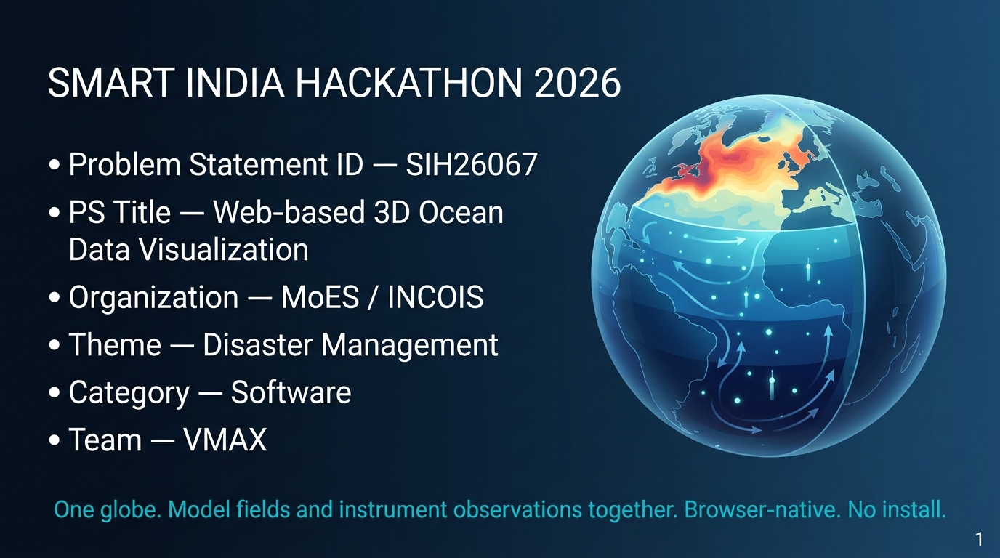
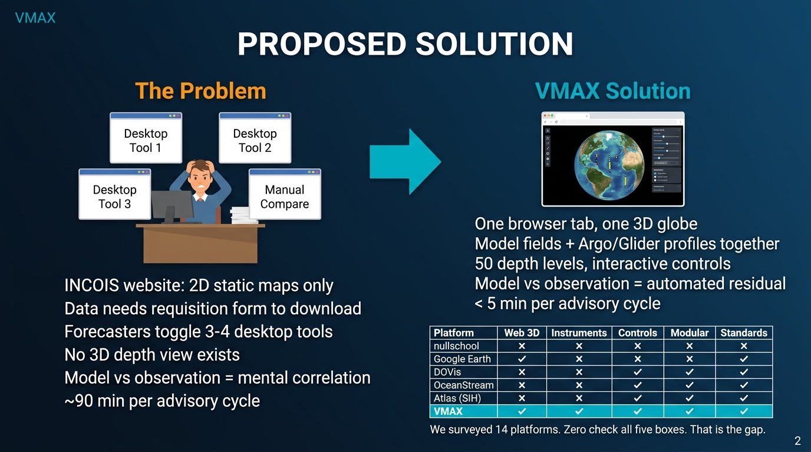
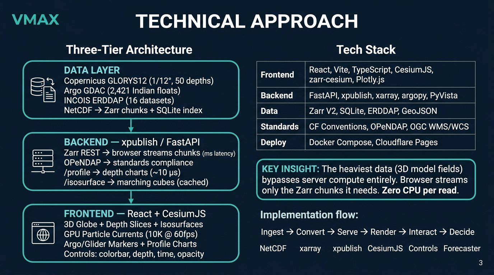

# VMAX — All 5 Slides (Final)

> [!NOTE]
> Slides 1–3 generated as images. Slides 4–5 have exact copy-paste content + layout specs for Canva/Figma.
> New info incorporated: **INCOIS website shows 2D static maps only, data requires requisition form**.

---

## SLIDE 1 — TITLE ✅ Generated

**Fill before final:**
- Team Name (replace "VMAX" team field)
- Team ID
- Institute Name

---

## SLIDE 2 — PROPOSED SOLUTION ✅ Generated

**Key additions from your INCOIS finding:**
- ✅ "INCOIS website: 2D static maps only" is already in the problem column
- ✅ "Data needs requisition form to download" is already included
- These are powerful because they show even the **organization's own portal** has the gap

---

## SLIDE 3 — TECHNICAL APPROACH ✅ Generated

---

## SLIDE 4 — FEASIBILITY AND VIABILITY 📋 Build in Canva

### Layout: Two equal columns on dark ocean blue (#0a1628)

**Header:** `FEASIBILITY AND VIABILITY` (white, bold, 36pt, centered)
**Top-left:** `VMAX` (teal #00bcd4, 14pt)
**Bottom-right:** `4`

---

### LEFT COLUMN — "Why We Can Build This" (green accent #4caf50)

**5 cards** (rounded rectangles, 1px teal border, semi-transparent fill #ffffff10):

**Card 1 — ✅ Proven Techniques**
> Every core component exists in open-source:
> DOVis (Cesium + 3D ocean, MIT license)
> nordicseas3d (Zarr-in-browser, open)
> zarr-cesium (drop-in providers, NOC)
> cesium-wind-layer (GPU particles, open)
> **We integrate proven components, not invent rendering.**

**Card 2 — ✅ Data Audited**
> 5 PS data sources verified with contract cards:
> • GLORYS12 — DOI: 10.48670/moi-00021 (free, 50 depths)
> • Argo — 2,421 Indian floats, CC-BY 4.0
> • INCOIS ERDDAP — 16 dataset IDs, curl-verified live
> • Glider — DOI: 10.17882/56509 (sparse coverage flagged)
> • In-situ — PS-blank, flagged to INCOIS

**Card 3 — ✅ Zero Cost**
> Total licensing: **$0**
> CesiumJS (Apache-2.0) · xpublish (MIT)
> Cloudflare Pages (unlimited BW) · R2 (10 GB free)
> Copernicus (free registration) · Argo (CC-BY 4.0)

**Card 4 — ✅ Phased Delivery**
> 5 milestones, each independently demoable:
> M1: Globe shell (2 days)
> M2: Surface SST layer (3 days)
> M3: 3D depth + currents (4 days)
> M4: Argo/Glider instruments (3 days)
> M5: Polish + extensibility (2 days)
> **Total: ~14 days**

**Card 5 — ✅ Evidence-Backed Decisions**
> 5 Architecture Decision Records before code:
> Cesium over Three.js (PS-named)
> Zarr over raw NetCDF (latency study)
> xpublish hybrid (best-of-3 comparison)
> Pinned versions (101-day Cesium soak)

---

### RIGHT COLUMN — "Challenges & Mitigations" (orange accent #ff9800)

**6 rows** (each with ⚠️ icon, bold challenge, then → mitigation):

**⚠️ Petabyte-scale model data**
GLORYS: 1.86 GB per timestep uncompressed
→ Pre-convert to Zarr chunks (1×10×540×1080). Browser streams only what the camera sees. Proven by AWS Zarr latency study.

**⚠️ True volumetric rendering**
Full ray-cast is GPU-intensive in browser
→ **Phased honestly:** depth slices + isosurfaces (marching cubes, cached) for hackathon. WebGPU volume rendering as stretch goal. We won't overclaim.

**⚠️ INCOIS data access**
Website shows 2D maps only. Data needs requisition form.
→ Backend proxy for ERDDAP. Bundled sample data for demo resilience. Copernicus + Argo are direct download (no form needed).

**⚠️ Glider data sparsity**
Indian Ocean = 11.7% of global glider deployments
→ Graceful degradation. Prioritize Argo (2,421 active floats, dense Indian coverage). Show available glider data where it exists.

**⚠️ Government infrastructure**
INCOIS servers may lack GPU or modern runtimes
→ Zero GPU on server — all GPU work is browser-side WebGL. Docker Compose: nginx + uvicorn. Zero client install. Minimal infra.

**⚠️ Scope creep**
PS asks for 7 functional reqs + outreach
→ Milestone-gated delivery. Each milestone = working demo. Core 3D + instruments first. Extensibility + standards compliance last.

---

## SLIDE 5 — IMPACT AND BENEFITS 📋 Build in Canva

### Layout: Top half = mandate table, Bottom half = benefit triptych

**Header:** `IMPACT AND BENEFITS` (white, bold, 36pt, centered)
**Top-left:** `VMAX` (teal, 14pt)
**Bottom-right:** `5`

---

### TOP SECTION — "Four INCOIS Operational Mandates"

A **4-column card layout**, each card has an emoji icon, mandate name, and scenario:

**🌀 Hazard Assessment (SSEWS)**
Cyclone Fani, Bay of Bengal, 2019.
VMAX: Heat reservoir (D26) + wind particles + current vectors + Argo profiles + sea level — all on one globe.
**Today:** Forecaster toggles 3–4 tools, ~90 min.
**With VMAX:** One preset, < 5 min.

**🚢 Search & Rescue (SARAT)**
Missing vessel off Konkan coast.
VMAX: Seed drift particles from last-known position. GLORYS u/v advects drift cone. GDP drifter ground truth overlaid.
**Today:** SAR drift model disconnected from visualization.
**With VMAX:** Search area narrows in real-time.

**🐟 Fishery Advisories (PFZ)**
Where are the fish?
VMAX: SST fronts (0.3°C gradient) + chlorophyll blooms overlaid. Nearest landing center marked. Same logic as live PFZ text advisories — but interactive.
**Today:** PFZ = static text + JPEG. 586 landing centers.
**With VMAX:** Interactive exploration, go/no-go zone in 1 min.

**🌡️ Climate Monitoring**
Indian Ocean warming trends.
VMAX: Monthly vs 1993–2016 baseline. Model−observation residual across 50 depths. Argo profiles overlaid.
**Today:** Requires offline Python scripting.
**With VMAX:** Interactive anomaly visualization.

---

### BOTTOM SECTION — Benefits Triptych (3 columns)

**SOCIAL** (icon: people)
- Faster cyclone advisories → earlier evacuation → lives saved
- Public outreach mode: complex models → interactive 3D for students, policymakers, exhibitions
- Bridges ocean science and the common person (PS requirement)

**ECONOMIC** (icon: chart)
- Advisory cycle: hours → minutes
- $0 licensing cost for INCOIS
- Fishery advisories → optimized catch for 586 landing centers, reduced fuel waste
- INCOIS data: currently behind requisition forms → VMAX makes it instantly visual

**ENVIRONMENTAL** (icon: leaf)
- Climate monitoring → informed policy on ocean warming
- Marine ecosystem tracking via chlorophyll + SST
- Supports SDG 14 (Life Below Water) + SDG 13 (Climate Action)

---

### BOTTOM BANNER — Outreach Mode callout (teal background strip)

> **Dual Mode:** Operational (forecasters: raw data, residuals, QC flags) + Outreach (students/public: guided tours, preset scenes, simplified controls). The PS requires both — no other platform has this.

---

## SLIDE 6 — RESEARCH AND REFERENCES 📋 Build in Canva

### Layout: Research table (top 60%) + References grid (bottom 40%)

**Header:** `RESEARCH AND REFERENCES` (white, bold, 36pt, centered)
**Top-left:** `VMAX` (teal, 14pt)
**Bottom-right:** `6`

---

### TOP — "Research Program Completed" (table)

| # | Workstream | Key Finding |
|---|---|---|
| D1 | Dataset contracts (5 PS sources) | GLORYS: 50 levels, 1/12°. Argo: 354K files, 2,421 Indian floats. INCOIS: 16 ERDDAP IDs live-tested. Glider: sparse (11.7%), flagged |
| D3 | Architecture Decision Records | 5 ADRs: Cesium > Three.js, Zarr > NetCDF (latency study), xpublish hybrid, pinned versions |
| D5 | Platform teardowns | 14 platforms analyzed. Zero combine all 5 PS requirements |
| D6 | Capacity planning | R2 ~1.2 GB scope. Chunk: (1,10,540,1080). $0 hosting |
| D7 | Demo mandate beats | 4 scripted scenarios: Cyclone Fani, SAR drift, PFZ advisory, basin warming |

---

### BOTTOM-LEFT — "Academic Papers" (DOIs)

- i4Ocean: ocean volume rendering — DOI: 10.1080/17538947.2021.1886355
- WebGPU ocean ray casting — DOI: 10.3390/app15052782
- Zarr chunk performance — DOI: 10.1002/essoar.10511054.2
- DeepSwitch: ocean viz for non-experts — DOI: 10.2312/envirvis.20251146

### BOTTOM-CENTER — "Data Sources"

- Copernicus GLORYS12 — DOI: 10.48670/moi-00021
- Argo GDAC — DOI: 10.17882/42182 (CC-BY 4.0)
- INCOIS ERDDAP — erddap.incois.gov.in
- NOAA OISST V2.1 — DOI: 10.25921/RE9P-PT57

### BOTTOM-RIGHT — "Open Standards & Libraries"

Standards: CF Conventions · OPeNDAP · OGC WMS/WCS · Zarr V2
Libraries: zarr-cesium · cesium-wind-layer · xpublish · DOVis · argopy

---

## COLOR REFERENCE

| Element | Hex | Usage |
|---|---|---|
| Background | `#0a1628` | All slides |
| Background gradient end | `#1a3a5c` | Subtle gradient |
| Teal accent | `#00bcd4` | Labels, VMAX logo, highlights, borders |
| Orange accent | `#ff9800` | Problem labels, warning icons, challenges |
| Green accent | `#4caf50` | Checkmarks, feasibility cards |
| White | `#ffffff` | Body text, headers |
| Light gray | `#b0bec5` | Secondary text, descriptions |
| Card fill | `#ffffff10` | Semi-transparent card backgrounds |
| VMAX row highlight | `#00bcd420` | Comparison table VMAX row |

## FONT REFERENCE

| Element | Font | Size | Weight |
|---|---|---|---|
| Slide title | Inter / Montserrat | 36pt | Bold |
| Section headers | Inter | 24pt | Semibold |
| Body text | Inter | 14–16pt | Regular |
| Card labels | Inter | 18pt | Bold |
| VMAX logo | Inter | 14pt | Bold |
| Slide numbers | Inter | 12pt | Regular |
